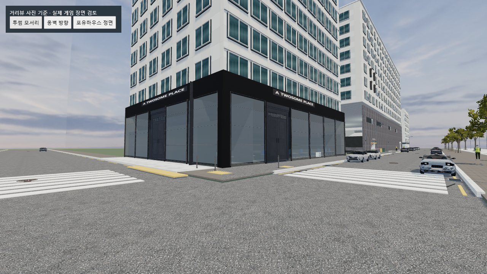
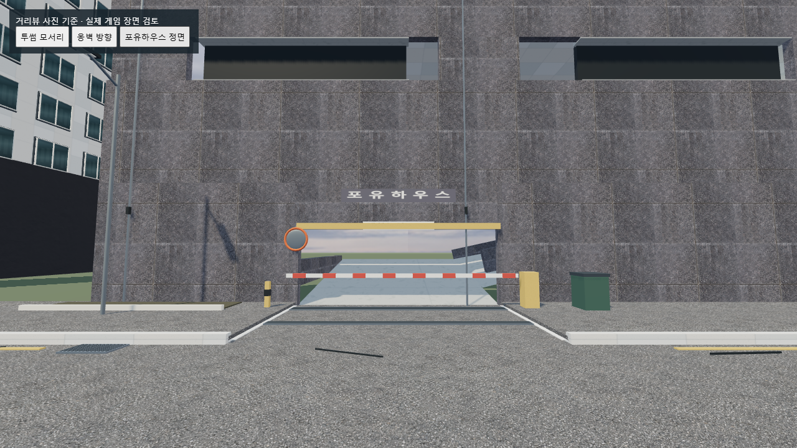
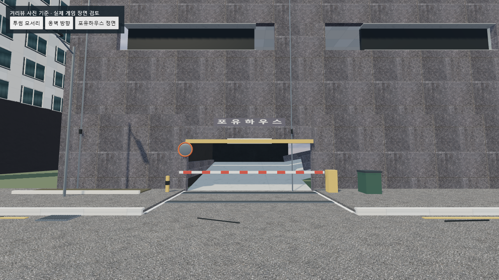

# 건물 빈틈 보완 — 2026-10-30

## 수정 내용

- 투썸 유리 상단(약 5.53m)과 기존 천장(약 6.64m) 사이에 남았던 틈을 외장 마감으로 닫았다.
- 유리 뒤쪽에 바닥·천장, 높이가 부족했던 북쪽/서쪽 벽을 넣었다. 유리의 투명도를 낮춰 가리는 방식이 아니라 실제 불투명 표면으로 하늘이 비치는 경로를 막았다.
- 유리 모듈 사이 이음새, 동쪽·남쪽 모서리, 처마 아래를 연속된 마감으로 연결했다. 간판은 새 마감 앞에 표시되도록 위치를 맞췄다.
- 포유하우스 주차장 경사로 하단의 회전 구간에 안쪽 벽과 경사진 천장 라이닝을 넣었다. 실제 차가 지나가는 입구와 위층으로 이어지는 경로는 열어 두었다.
- 도로·바닥/충돌 영역·차단기·좀비 시작/순찰 좌표와 플레이어 손·전투·스토리 소스는 유지했다.

## 실제 모델과 재질

새 표면은 이미 다운로드한 Poly Haven [Modular Urban Apartments Facade](https://polyhaven.com/a/modular_urban_apartments_facade)의 `wall_standard_standard_01` 메시를 편집·경량화한 것이다. [CC0](https://polyhaven.com/license)로 상업 이용 가능하다. 새로운 박스나 원기둥을 대체 모델로 생성하지 않았다.

`assets/models/exterior/street-detail/reference-edits/reference-building-closure.glb`에 실제 편집 메시와 원본 색상·노멀·러프니스 계열 텍스처를 포함했다. 내부 벽, 외장 마감, 주차장 라이닝으로 재질을 나눠 인스턴스를 공유한다.

패널 175개를 3개 렌더 배치로 추가했다. 추가 삼각형은 15,925개다. 앞선 거리 소품까지 합치면 100,640 삼각형, 모델 배치 9개다. 이 값은 전체 게임의 렌더 수치가 아니다.

제작 스크립트: `qa/build-building-closure.py`. 편집 가능한 원본: `qa/building-closure-source.blend`.

## 검사

- `qa/street-reference-test.cjs`: 이전 실제 게임과 도로·바닥·충돌체·경사로 높이·차단기·랜드마크·좀비 배치/순찰 좌표 동일.
- 7개 시선 검사: 카페 천장, 북쪽/서쪽 벽, 유리 이음새, 모서리, 주차장 서쪽 벽/천장에 불투명 모델이 존재함을 확인했다. 이는 지정 시점 검사이며 모든 시점의 완전한 기하학 보장을 뜻하지 않는다.
- 주차장 출구 방향은 막히지 않음. 회전 구간의 다섯 위치에서 바닥 위 2.6m 이상 천장 여유를 확인했다.
- `qa/ramp-route.cjs`, `reference-detail-test.cjs`: 별도 주행/기존 지형·표면 검사.
- 실제 WebGL 비교 화면과 로딩 결과는 `qa/building-fill-after-*.png`, `qa/building-fill-after-browser.json`에 기록한다.
- 최종 실제 게임 폴더에서 GLB 5종과 추가 마감 재질을 정상 로드했다. 실행 오류와 실패한 모델/텍스처 요청은 모두 빈 목록이다. 같은 검사 카메라 세 곳에서 최종 화면을 확인했다.
- 소프트웨어 렌더링 검사에서 마지막 시점은 950 렌더 호출, 1,408,560 렌더 삼각형(그림자 패스 포함)이었다. 마지막 단축 검사의 프레임 표본은 27개, 중앙 FPS는 약 0.218이다. 변경 전부터 매우 느린 검사 환경이므로 실제 플레이 성능을 보증하지 않으며, 성능 개선으로 보고하지 않는다.

## 범위와 한계

보이는 빈틈을 닫는 작업이며, 확인되지 않은 실제 카페 내부 구조를 정밀 복원한 결과는 아니다. 기존 실내 가구와 먼 배경은 이번 범위에 포함하지 않았다. 소프트웨어 렌더링 검사 환경의 프레임은 실제 GPU가 있는 PC의 성능을 대표하지 않는다.

수정한 제품 파일: `index.html`, `streets.js`(간판 시각 위치), `street-reference-upgrade.js`, 새 마감 GLB와 라이선스 문서. 기존 파일 백업은 `qa/backups/building-fill-20261030-132044/`, 최종 파일 해시 기록은 `qa/building-fill-apply-result.json`이다.

## 같은 시점 비교

