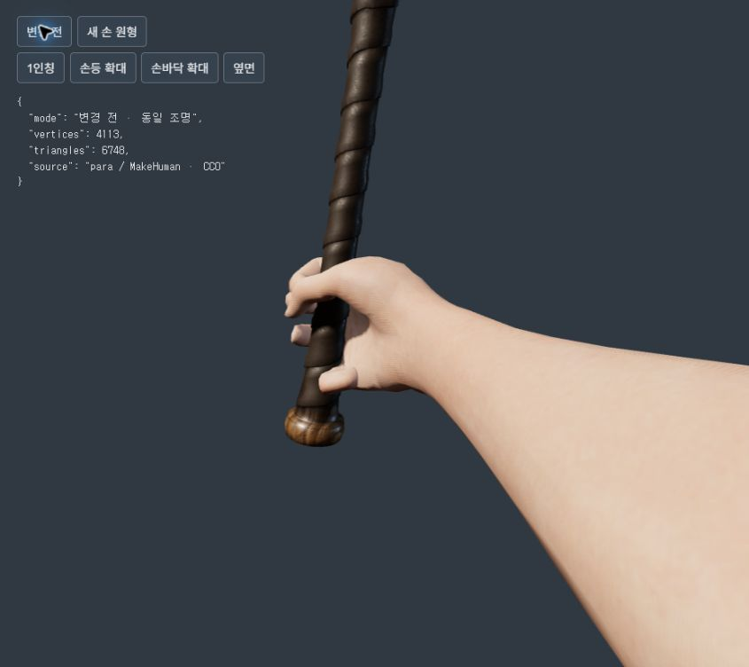
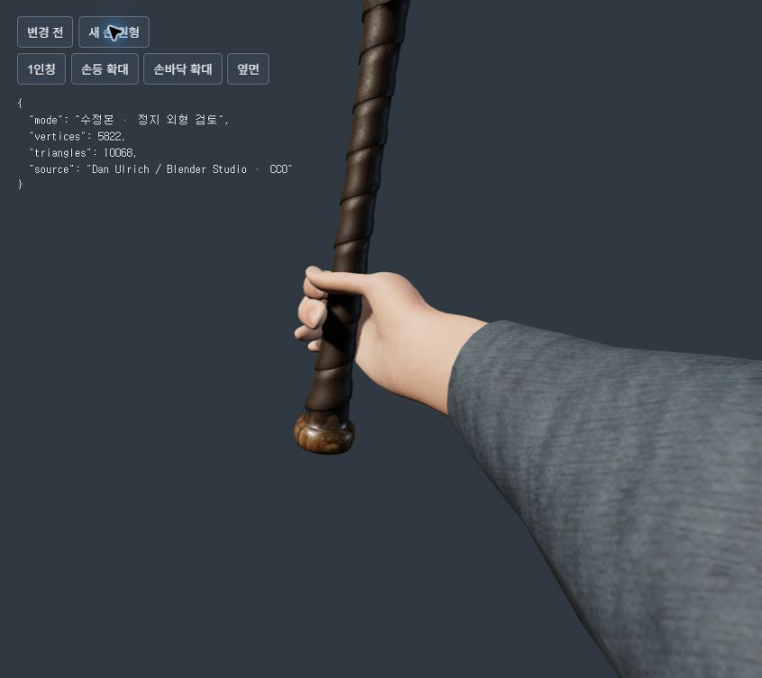
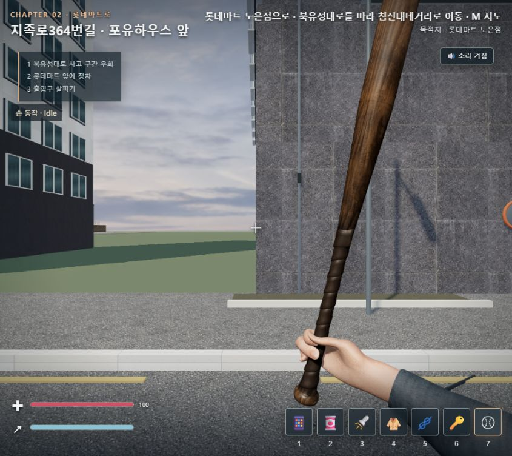

# 1인칭 손 외형 교체 결과 — 2026-10-30

## 적용 내용

- 기존 손 메시를 Blender Studio의 Dan Ulrich `Hand - Realistic` 원본으로 교체했다. 원본의 다중 해상도 디테일을 적용하고 기존 팔 리그에 맞춰 스키닝했다. 구체·원기둥으로 손을 만들지 않았다.
- 엄지 관절 비율, 네 손가락의 손잡이 감싸는 자세, 반대편 엄지 위치를 수정했다. 실제 야구방망이의 굵기를 측정해 손 표면을 조정했다.
- 모델에 실제 `Grip_R` 관절을 추가했다. 손과 무기는 같은 관절에 연결되며 대기·걷기·달리기·공격 중 연결을 유지한다.
- 기존 실제 팔 메시를 소매와 소맷단으로 편집하고 Poly Haven의 직물 PBR 텍스처를 적용했다.
- 손 피부에 색상·노멀·러프니스 맵을 연결하고 손/무기의 자체 그림자를 적용했다.
- 야구방망이는 기존 Poly Haven 실제 모델을 재사용했다. 다른 종류의 무기로 교체한 작업은 아니다.

## 실제 무료 에셋과 라이선스

| 에셋 | 출처 | 사용 범위 | 라이선스 |
|---|---|---|---|
| Hand - Realistic / Dan Ulrich | [Blender 공식 배포](https://www.blender.org/download/demo-files/#assets), [로그인 없는 직접 다운로드](https://download.blender.org/demo/asset-bundles/human-base-meshes/human-base-meshes-bundle-v1.4.1.zip) | 새 손 메시, 원본 UV·다중 해상도 디테일 | 원본 에셋 메타데이터 CC0 |
| FPS arms / para·MakeHuman | [OpenGameArt](https://opengameart.org/content/fps-arms-rigged-only) | 팔 메시·리그·기존 피부 색상 | CC0 |
| Jogging Melange / colormass·Rico Cilliers | [Poly Haven](https://polyhaven.com/a/jogging_melange) | 실제 직물 색상·OpenGL 노멀·러프니스 | CC0 |
| Baseball Bat / Enrique Martín | [Poly Haven](https://polyhaven.com/a/baseball_bat) | 기존 실제 방망이 모델·재질 재사용 | CC0 |

로그인 없이 확보했다. CC0는 상업적 이용·수정을 허용한다. 원본 정보와 출처는 `assets/models/hands/studio-fps/LICENSE.md` 및 `source/`에 보관했다.

## 텍스처와 모델 규모

- 피부 색상: 기존 MakeHuman 1024px 이미지를 새 손 UV에 실제 베이크했다.
- 피부 노멀·러프니스: 각각 2048px, 직접 제작한 미세 표면·손톱 마스크다. 새로 다운로드한 고해상도 피부 스캔 텍스처가 아니다.
- 소매: 실제 다운로드한 Jogging Melange의 세 맵을 각각 1024px로 재인코딩했다.
- 손 6,596 삼각형, 소매 800 삼각형, 합계 7,396. 기존 방망이를 포함하면 10,068 삼각형이다.
- 관절 27개, 손가락 5개, Idle·Walk·Run·Attack 네 클립.
- 편집 가능한 원본: `assets/models/hands/studio-fps/source/hand-rigged.blend` (텍스처 포함).

## 검사 결과와 한계

- `qa/fps-rig-test.cjs`: 통과. 실제 GLTF·버퍼·PNG 파일, 관절·소켓·파지 연결, 중립 손목, 이동↔공격 연결을 검사했다.
- 9개 상태에서 정점·변 중점·삼각형 중심을 포함한 415,548개 표본을 검사했다. 측정한 방망이 손잡이의 반지름 경계 안으로 들어간 표본은 없었으며 최소 간격은 약 0.439mm였다. 연속 시간·모든 표면에 대한 완전한 충돌 보장은 아니다.
- `chapter-test.cjs`: 기존 공격·피격·쿨다운·사망·재시도·진행 검사 통과.
- `smoke-test.js`: 기존 이동·충돌·아이템·상호작용·주요 진행 검사 통과. 이 두 검사는 브라우저 없는 자동 검사다.
- 앞선 실제 브라우저 실행에서 새 손·옷감·방망이 렌더링을 확인하고 대기 화면을 저장했다. 같은 조명·시점의 변경 전후 정지 화면도 저장했다.
- 마지막 재접속 시 브라우저 제어가 초기화되어 Chrome 연결이 없어졌고, 내장 브라우저의 로컬 게임 접속은 시간 초과됐다. 따라서 최종 복사 후 브라우저 재검사, 걷기·공격 스크린샷, 브라우저 오류 목록과 FPS 수치는 이번 결과에 포함하지 않는다. 확인하지 않은 수치를 성공으로 보고하지 않는다.
- 현재 자세는 이 방망이의 닫힌 파지에 맞춘 것이다. 다른 무기나 손을 펴는 동작은 별도 작업이 필요하다.

## 변경 파일

- `fps-viewmodel.js`: 실제 Grip_R 연결, 손·소매 재질 상태, 손 자체 그림자.
- `model-upgrade.js`: 새 손 GLTF 로딩 경로.
- `index.html`: 위 스크립트 캐시 버전.
- `assets/models/hands/studio-fps/`: 모델·버퍼·6개 텍스처·라이선스·편집 원본.
- `qa/`: 제작 스크립트, 리그 검사와 결과, 정지 비교 및 게임 대기 이미지.

게임의 공격 판정 시점·속도·데미지·스태미나 규칙은 변경하지 않았다. 건물·도로·스토리·좀비 AI 소스는 이번 적용에서 수정하지 않았다.

## 실제 렌더링 이미지

변경 전과 후는 같은 검토 시점·조명이다. 정지 외형 검토 화면이며 게임 중 공격 장면으로 표시하지 않는다.

아래는 앞서 실제 게임에서 저장한 새 손 대기 화면이다.

