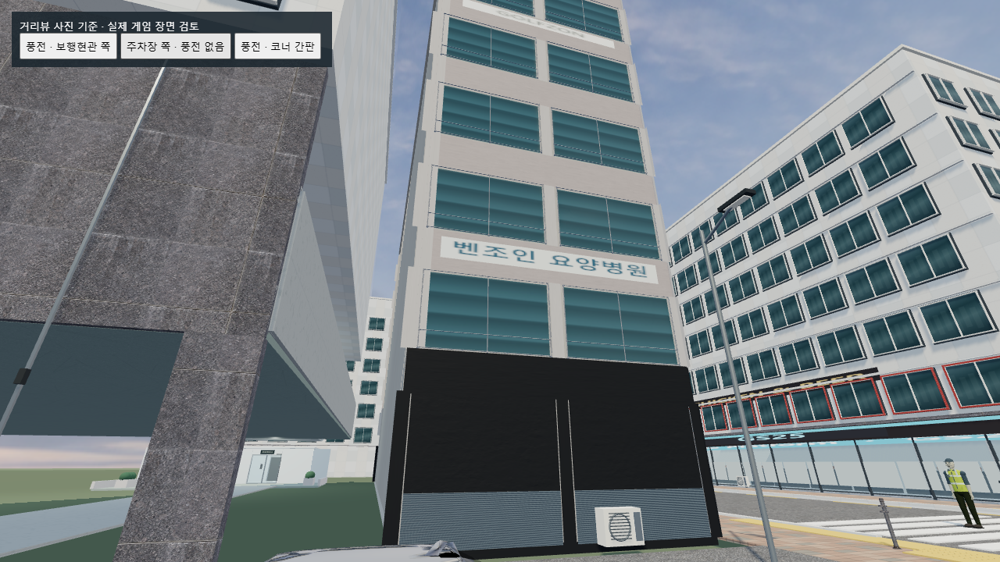
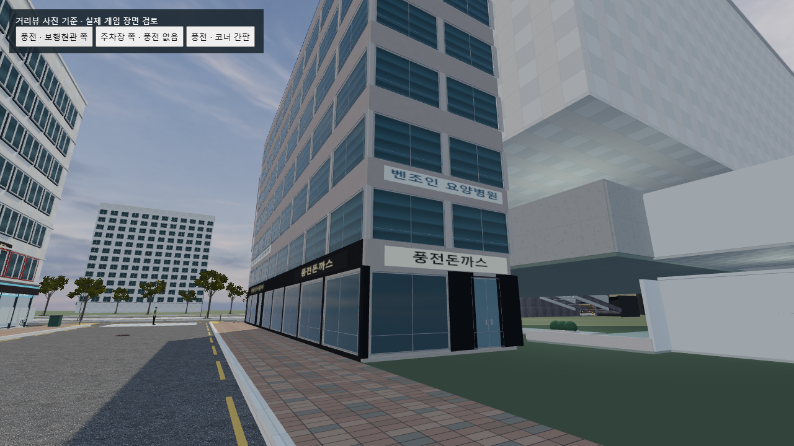

# 풍전돈까스 위치 정정 — 2026-10-30

이전 작업에서 포유하우스의 **주차장 면과 보행현관 면을 같은 방향으로 연결한 것이 오류**였다. 사진의 앞뒤면을 제대로 연결하지 않은 채 풍전돈까스 간판과 출입문을 주차장 쪽에 배치했다.

## 이번에 직접 확인한 네이버 거리뷰

- [보행현관 쪽](https://map.naver.com/p?c=17.00,0,0,0,adh&p=9HFpXSeej2Av6rXIjrgIbw,11,-9.75,64.69,Float): 포유하우스 보행현관 옆 건물에 풍전돈까스의 흰색 본 간판이 있고, 코너를 돌아 검은 바탕의 금색 측면 간판이 이어진다.
- [주차장 쪽](https://map.naver.com/p?c=17.00,0,0,0,adh&p=0nG_nrxiEedlsyztTS9Few,-51.28,10,64.69,Float): 포유하우스 차량 출입구와 이웃 건물의 설비/막힌 저층 면이 보이며, 위의 풍전돈까스 본 간판은 이 면에 있지 않다.
- 두 화면 모두 네이버가 표시한 촬영 시점은 **2025년 3월**이다. 2026년 현재 영업 여부를 새로 확인한 결과는 아니다.

네이버 지도의 미니맵을 확대해 서로 반대편 길임을 확인하고, 실제로 반대편 거리뷰 지점으로 이동해 대조했다. 화면은 `qa/naver-pungjeon-pedestrian-side.png`, `qa/naver-clinic-parking-face.png`에 기록했다. 네이버 화면은 위치 확인용 QA 자료이며 게임 텍스처로 사용하지 않았다.

## 수정

- 게임의 주차장 쪽(+X) 풍전돈까스 간판을 제거했다.
- 흰색 본 간판, 매장 유리문·손잡이·매장 창·출입구 마감을 반대편 보행현관 쪽(-X)으로 옮겼다.
- 코너의 검은색 측면 간판은 그쪽 끝으로 분리 배치했다. 명륜진사갈비 표시도 반대쪽 상가 구간과 겹치지 않도록 정리했다.
- 보행현관 쪽 상층 창과 외벽 마감도 이어 붙였다. 빈 벽에 간판만 붙인 상태로 남기지 않았다.
- 주차장 쪽 저층 면은 어두운 막힌 면과 금속 설비 마감으로 구성했다. 금속 골은 직접 제작한 노멀맵 표현이며 새로 다운로드한 금속 사진이라고 보고하지 않는다.

여기서 +X/-X는 **기존 게임 좌표**이며 지리상의 실제 동서 방위를 뜻하지 않는다. 기존 건물 위치·치수는 여전히 게임용 근사치다. 이번 수정은 해당 매장의 앞뒤면 배치를 바로잡는 작업이며, 거리 전체의 도로 구조와 동선을 새로 측량·복원한 결과는 아니다.

## 검사

- 기존 도로·바닥·충돌체·경사로 경로·좀비 시작/순찰 좌표, 디하이브/투썸 장면 상태 유지.
- 회귀 검사: 풍전돈까스 본 간판은 보행현관 면에 있어야 하고, 주차장 면에는 풍전돈까스 간판과 그 매장 유리문이 남아 있으면 실패하도록 했다.
- 기존 GLB 네 종류를 그대로 재사용했다. 본 간판/측면 간판 2개, 상층 창 72개, 매장 창 8개, 출입구 2개, 주차장 쪽 설비 패널 2개.
- 건물 모델은 84,497 삼각형, 모델 렌더 배치 13개. 간판 평면은 별도다.
- 실제 브라우저 검사와 화면: `qa/pungjeon-location-after-browser.json`, `qa/pungjeon-location-after-*.png`.
- 실제 게임 폴더를 대상으로 Chrome WebGL 검사 화면에서 네 종류 GLB와 재질 로딩을 확인했다. 최종 결과는 `loaded: true`, 콘솔 오류 0건, 실패 요청 0건이다. 일반 플레이 전체를 재검증한 결과는 아니며, 필요한 시점만 렌더링하는 장면 검사이므로 FPS 측정 결과도 아니다.
- 보행현관 쪽에서 실내 복도 소품이 외부에 떠 보이는 기존 표시 오류를 함께 수정했다. 복도 GLB 소품과 PBR 바닥을 기존 실내 표시 레이어에 맞췄다. `qa/corridor-layer-test.cjs`에서 메시 22개의 외부 숨김/실내 표시를 확인했다. 소품 위치와 상호작용은 바꾸지 않았다.

실제 게임 폴더 `C:/Users/lyj/git/-zombi-game`에 적용하고 원본은 `qa/backups/pungjeon-location-20261030-141939`에 보관했다. 적용 파일과 해시는 `qa/pungjeon-location-apply-result.json`에 기록했다. 포유하우스 보행현관 쪽 외관과 주변 도로는 아직 단순화된 상태로 남아 있다.

## 비교

