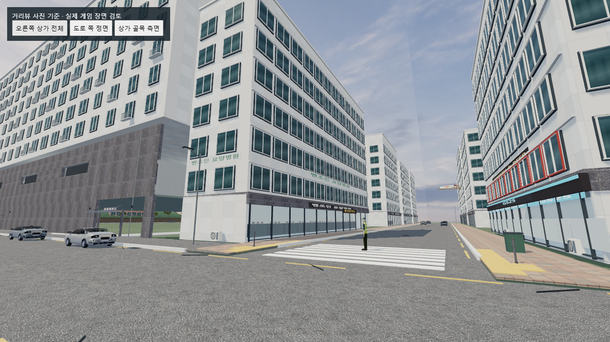
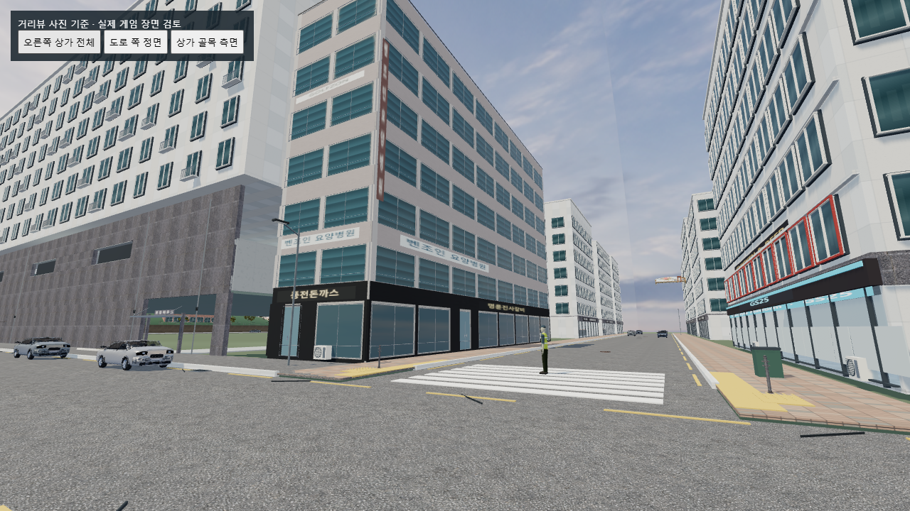
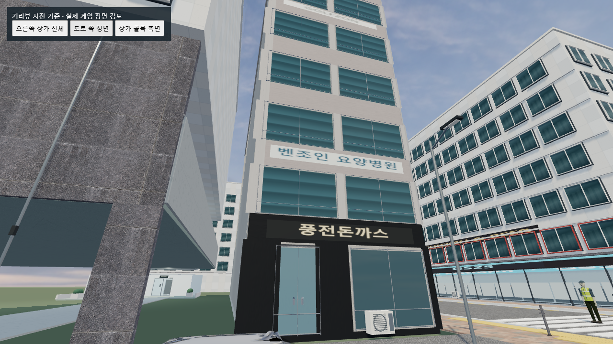

# 포유하우스 주차장 기준 오른쪽 건물 — 2026-10-30

**위치 정정:** 아래 1차 작업은 풍전돈까스의 앞뒤 면 연결에 오류가 있었다. 네이버 거리뷰 양쪽 면을 다시 직접 확인해 수정했다. 최신 배치는 [풍전돈까스 위치 정정](PUNGJEON_LOCATION_CORRECTION.md)을 참고한다. 아래 수치/화면은 최초 상세화 당시의 기록이다.

## 대상과 근거

주차장 정면을 바라봤을 때 오른쪽의 **벤조인 요양병원·풍전돈까스 상가**를 대상으로 했다. 저장된 거리뷰 원본 `005949`, `010024`, `010040`, `010151`, `010204`를 직접 확인했다. 디하이브/투썸 쪽은 이번 대상으로 바꾸지 않았다.

확인한 특징: 밝은 석재와 옅은 분홍빛 층 띠, 청록색 연속 창과 블라인드, 검은 저층 상가 마감, 병원·식당 간판, 수직 간판, 어두운 옥상 마감. 사진 `005949`는 2026년 8월, 나머지 주요 사진은 2025년 3월 화면이다. 실시간 거리뷰 재접속 또는 현장 측량을 했다고 주장하지 않는다. 상호는 사진 속 표시를 재현한 것이며 현재 영업 여부를 안내하지 않는다.

## 실제 적용

- 기존 병원 건물의 위치·너비·깊이·높이와 충돌체를 유지하고 화면 메시를 별도 GLB 구성으로 교체했다.
- 상층 창 60개, 저층 상가 창 8개, 유리 출입구 2개와 실제 손잡이/잠금장치 메시.
- 외벽·층 띠·코너 기둥·검은 상가 마감, 옥상 두겁과 얕은 출입구 캐노피.
- 건물의 바닥·천장·네 벽을 닫아 비어 보이는 면을 방지했다. 뒷면은 사진으로 확인되지 않아 보수적인 폐쇄 외벽으로 처리했다.
- 병원, 풍전돈까스, 명륜진사갈비, GOLFZON과 수직 병원 간판을 참고 배치했다. 작은 글씨·전화번호·불명확한 임차인 표시는 임의로 만들지 않았다.

네 파일의 GLB를 읽는다: `clinic-window`, `clinic-entry`, `clinic-cornice`, `clinic-cladding`. 모두 기존 다운로드한 Poly Haven CC0 모델을 실제 편집한 결과다. 창의 블라인드 색상은 직접 제작한 표현이며, 외벽 사진 질감의 명도도 조정했다. 다운로드한 원본과 직접 제작한 부분은 `assets/models/exterior/right-building/LICENSE.md`에 구분했다.

이 건물의 모델은 71,746 삼각형, 12개 모델 렌더 배치다. 간판 평면 6개는 별도다. 전체 게임 수치와 혼동하지 않는다.

## 보존 및 검사

- `qa/right-building-test.cjs`: 도로·바닥·충돌·차단기·경사로 경로·좀비 시작/순찰 좌표 설치 전후 동일. 디하이브/투썸의 기존 장면 상태 불변. 기존 병원 메시가 성공 시에만 숨겨짐을 확인.
- 6방향 시선 검사로 새 건물 바닥·천장·네 벽의 폐쇄 표면 확인. 새 모델이 차도·보행 경로로 침범하지 않는 범위도 검사.
- 실제 GLB 파싱, UV·노멀, 인스턴스 범위, 모델 수와 삼각형 예산 검사.
- `reference-detail-test.cjs`, `qa/ramp-route.cjs`: 기존 표면·랜드마크와 경사로 → 차단기 → 도로 합류 검사 통과. 차량 내구도 100 유지.
- 브라우저 결과는 `qa/right-building-after-browser.json`, 비교 화면은 `qa/right-building-before/after-*.png`에 저장한다. 실제 제품의 월드와 모델 로더를 사용하는 같은 검사 카메라의 WebGL 화면이다.
- 최종 실제 게임 폴더에서 GLB 4종과 포함된 텍스처 로딩 성공, `rightBuilding.loaded=true`, 실행 오류 `[]`, 실패한 모델/텍스처 요청 `[]`를 확인했다. 같은 검사 시점 세 곳을 캡처했다. 이 화면은 일반 플레이 HUD/AI를 실행한 플레이 장면과 구분한다.

마지막 동일 검사 시점의 소프트웨어 렌더링 수치(그림자 패스 포함):

| 항목 | 변경 전 | 변경 후 |
|---|---:|---:|
| 렌더 호출 | 1,203 | 1,187 |
| 렌더 삼각형 | 1,790,312 | 1,914,344 |
| 프레임 표본 | 30 | 29 |
| 중앙 FPS | 약 0.253 | 약 0.237 |

모델 공유로 호출 수는 줄였으나 이 검사에서 프레임 저하도 관찰했다. 소프트웨어 검사 환경의 수치이며 실제 PC에서의 성능 개선이나 안정적인 플레이 프레임을 입증한 결과가 아니다.

## 변경 파일과 한계

`right-building-upgrade.js`, `exterior-upgrade.js`(호출 연결), `street-details.js`(성공 후 기존 표시를 제거할 수 있도록 배치 병합 제외), `index.html`, 새 GLB·라이선스·QA 파일.

플레이어 손·무기·전투·스토리·AI 소스는 수정하지 않았다. 새 병원 실내 진입 기능도 추가하지 않았다. 사진에 보이지 않는 치수, 각 창/문 위치, 옥상과 뒷면은 근사치다. 기존 맵의 단순화된 건물 폭·깊이를 유지했으므로 1:1 복원이 아니다. 전용 냉난방기·상가 어닝·실내 가구 모델은 아직 확보/교체하지 않았다.

소프트웨어 렌더링 검사 환경은 이전부터 프레임이 매우 낮다. 실제 GPU가 있는 PC의 성능을 보증하거나 60fps를 달성했다고 보고하지 않는다.

원본 파일 백업: `qa/backups/right-building-20261030-135358/`. 최종 적용 파일 해시와 보호한 소스의 불변 확인은 `qa/right-building-apply-result.json`에 기록했다.

## 같은 시점 비교

