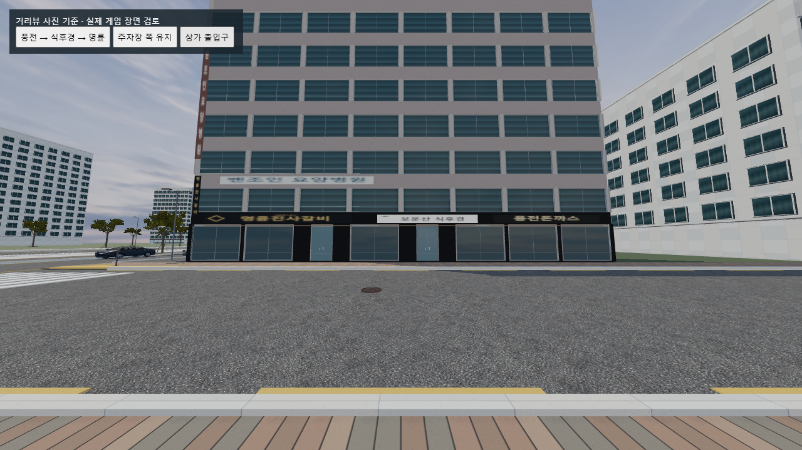
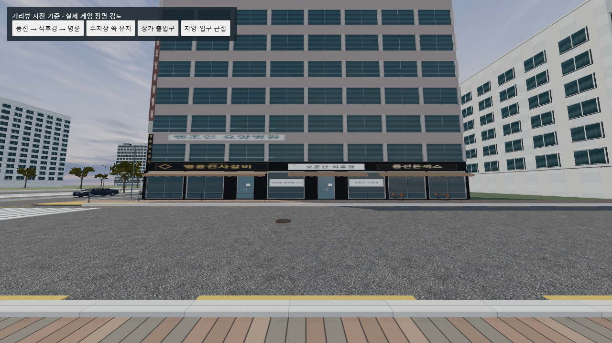
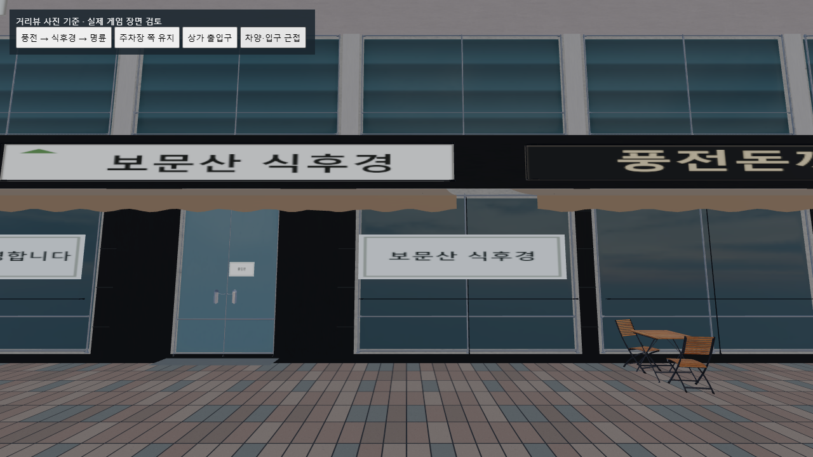

# 상가 근접 디테일 보강 — 2026-10-30

풍전돈까스·보문산 식후경·명륜진사갈비 구간의 건물 위치와 상가 순서를 유지하며 외관 디테일을 보강했다. 아래는 실제 적용 범위이며, 매장 전체나 임시 천막까지 정확히 복원한 결과는 아니다.

## 모델과 재질

- **새 다운로드:** [Outdoor Table Chair Set 01](https://polyhaven.com/a/outdoor_table_chair_set_01), James Ray Cock / Poly Haven. GLTF와 바이너리, 1K 컬러·노멀·ARM 텍스처 등 원본 파일 8개를 로그인 없이 다운로드하고 제공 MD5와 대조했다. [CC0 라이선스](https://polyhaven.com/license)로 수정·재배포·상업 이용 가능.
- 원본은 `assets/models/exterior/right-building/outdoor-table-source/`, 다운로드 명세는 `qa/shop-detail-downloads/outdoor-table-files.json`에 보관했다. Blender로 `shop-patio.glb`로 변환하고 테이블·의자 세트 2개를 배치했다.
- **`shop-awning.glb`:** 기존 CC0 외벽 표면 메시를 Blender에서 경사진 천 표면·앞단 처짐으로 변형하고, 기존 CC0 금속 기둥 메시에서 가져온 지지대를 붙인 편집 모델이다. 완제품 차양 모델을 다운로드했다고 주장하지 않는다. 기존 Poly Haven `jogging_melange` 노멀·러프니스 지도를 512px로 줄여 재사용했고 갈색은 직접 지정했다.
- **`shop-metal-profile.glb`:** 기존 Poly Haven Modular Chainlink Fence의 실제 금속 기둥 메시에서 가져온 마감 프로파일이다. 노멀·ARM 데이터를 유지하고 검은 알루미늄 색으로 조정했다. 새 BoxGeometry 소품을 만들지 않았다.
- 원본 출처와 기존 재질 라이선스는 `assets/models/exterior/right-building/LICENSE.md` 및 `assets/models/hands/studio-fps/LICENSE.md` 참조.

## 화면에 보이는 변경

- 얇은 처마 형태였던 차양을 경사·앞단·지지대가 있는 4개 GLB 차양으로 교체.
- 간판 테두리 및 매장 유리 분할 프로파일 24개.
- 명륜 쪽 낮은 테라스 난간 부재 11개. 풍전 쪽 접이식 테이블과 의자 2세트.
- 출입문 아래 문턱 2구간, 식후경의 흰색 창문 필름과 출입문 안내 4개.
- 하부 벽기둥의 석재 줄눈 36개는 한 묶음으로 렌더링한다. 줄눈과 안내문은 직접 만든 표면 디테일이며 별도 스캔 에셋이라고 보고하지 않는다.
- 차양·좌석·난간에 그림자 생성 적용. 기존 게임 조명과 부드러운 그림자 설정을 사용했다.

거리뷰 참조는 [명륜 앞 지점](https://map.naver.com/p?c=17.00,0,0,0,adh&p=frOXxn1K994dhCPdRwdTYQ,-16.04,-17.29,64.69,Float)의 2025년 3월 화면이다. 사진을 건물 텍스처로 복제하지 않았다. 원본의 흰 임시 천막과 정확히 같은 모델은 이번에 확보하지 못해 추가하지 않았다.

## 검증

- `qa/right-building-test.cjs` 통과: 건물 위치·도로·충돌체·경사로·좀비 시작/순찰 좌표 및 투썸 장면 유지, 외벽 폐쇄, 상가 순서, 외부 표시/실내 숨김 확인.
- 보강된 외관의 수평 범위는 X 17.70–51.23 / Z 6.805–15.65. 앞 도로의 끝 Z=5와 1.805 게임 단위의 간격을 두었다. 새 충돌체는 추가하지 않았다.
- GLB 인스턴스 합계 117,229 삼각형 / 23 렌더 묶음. 직전 대비 32,060 삼각형 / 9묶음 증가. 간판·필름·줄눈 평면은 별도이며 전체 게임의 프레임 성능을 나타내는 숫자는 아니다.
- 원래 늘어나 있던 차양 메시를 줄여 위 예산 안에 맞췄다. 신규 GLB 3개 합계 약 4.40MB, 런타임 외부 API 호출 없음.
- 실제 게임 폴더의 Chrome WebGL 장면 검사는 `qa/shop-detailing-after-browser.json`과 화면 4장으로 기록한다. 정지 장면 검사이므로 FPS 검증이나 모든 게임플레이의 수동 재검증을 뜻하지 않는다.

## 변경 파일

`right-building-upgrade.js`, `index.html`, 위 GLB 3개, 원본 다운로드·라이선스 기록, `qa/build-shop-details.py`, `qa/right-building-test.cjs`, `qa/street-review.cjs`. 편집 원본은 `qa/shop-detail-source.blend`.

