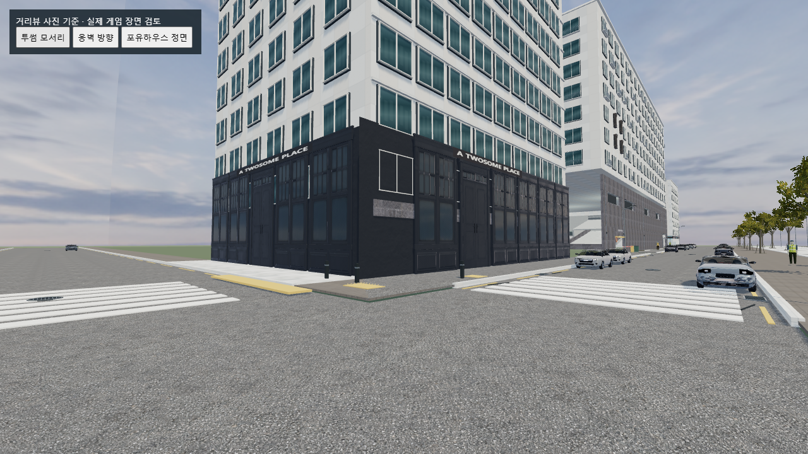
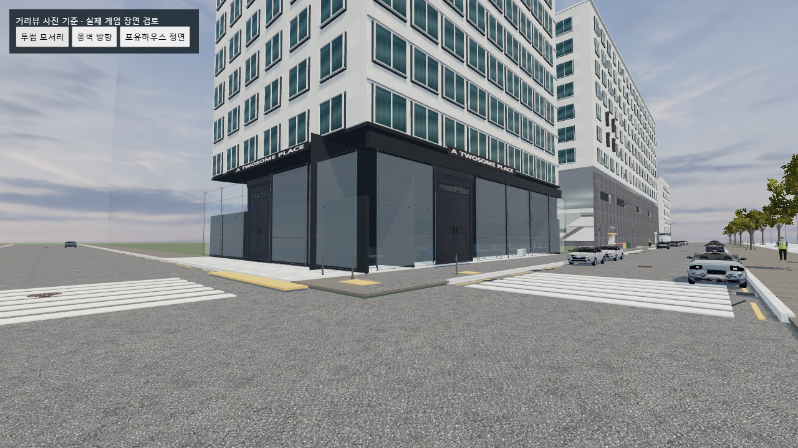
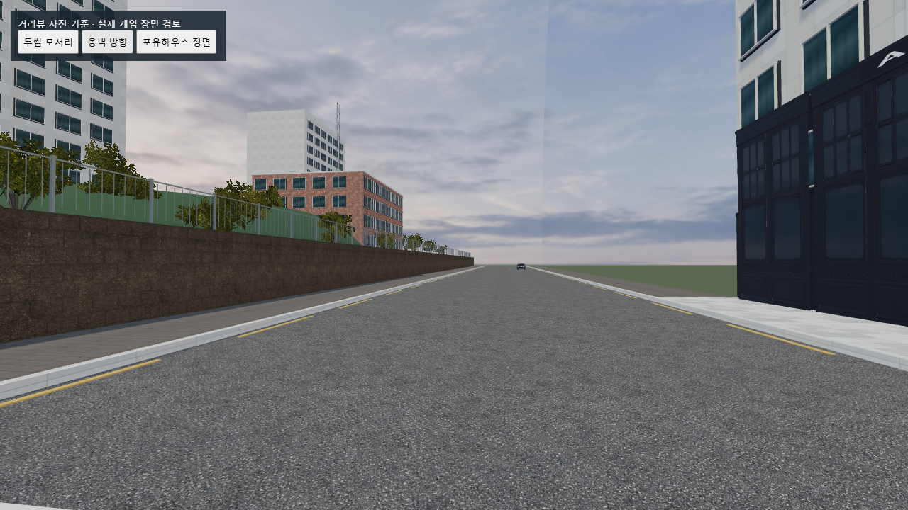
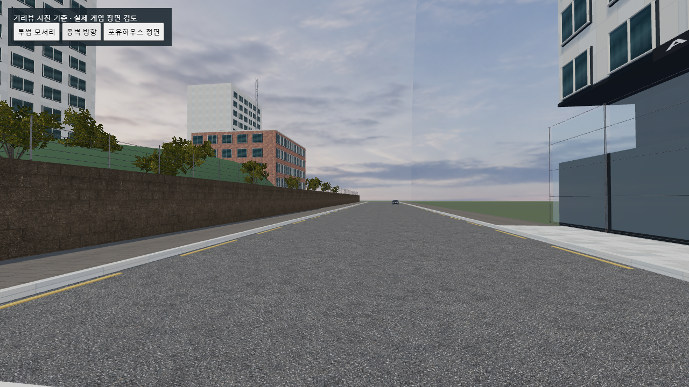

# 거리뷰 기준 외부 상세화 1차 — 2026-10-30

후속 수정으로 건물의 벽·천장·모서리 빈틈을 보완했다. 아래 수치는 1차 작업 당시 기록이며, 최신 변경은 [건물 빈틈 보완](BUILDING_FILL.md)을 참고한다.

## 기준과 범위

사용자가 제공한 원본 `010108`, `010125`, `010139`의 투썸 모서리·횡단보도·옹벽 도로를 기준으로 작업했다. 사진 `010024`가 포유하우스 정면 자체라는 사용자 확인을 유지했다. 사진들은 2025년 3월 거리뷰이며 현재 현장 상태나 측량 치수를 보증하지 않는다.

[지정 네이버 거리뷰](https://map.naver.com/p?c=17.00,0,0,0,adh&p=9HFpXSeej2Av6rXIjrgIbw,44.69,-9.75,80,Float)는 이번 검색 도구에서 열리지 않았다. 실시간으로 다시 보았다고 주장하지 않으며, 저장된 원본 사진을 직접 확인했다.

## 적용

- 투썸 저층부의 촘촘한 기존 창 모듈 9곳을 실제 모델에서 편집한 넓은 유리면·얇은 금속 수평바 모델로 교체했다. 모서리까지 창 폭을 맞추고 내부 벽/천장과 겹치는 기존 시각 구조를 정리했다.
- 기존 실제 모델 출입문 두 곳은 유지하고 새 창 폭에 맞췄다. 새 전용 출입문 모델을 확보한 결과는 아니다.
- 볼라드 8개: 다운로드한 실제 기둥·브래킷을 편집한 GLB로 기존 표시를 교체했다.
- 맨홀 7개: 실제 다운로드한 맨홀 GLTF를 경량화한 GLB로 교체했다.
- 옹벽 위와 옆길 난간 75구간: 실제 금속 기둥 모델을 편집한 수평 난간 GLB로 구성했다. 원본 철망은 사진과 달라 쓰지 않았다.
- 사진의 옹벽 도로 표지를 참고해 평면 도로 페인트 `30` 두 곳을 추가했다. 건물이나 소품의 박스 대체 모델이 아니다.
- 재질: 실제 1K 금속/맨홀 Diffuse·OpenGL Normal·ARM, 기존 외벽 키트 Normal·Roughness와 유리 물리 재질을 사용했다. GLB에 텍스처를 포함했고 런타임 외부 API 요청은 없다.

## 출처와 무료 이용

새 다운로드: [Modular Chainlink Fence](https://polyhaven.com/a/modular_chainlink_fence), [Water Manhole Cover](https://polyhaven.com/a/water_manhole_cover).
기존 다운로드 재사용: [Modular Urban Apartments Facade](https://polyhaven.com/a/modular_urban_apartments_facade).
모두 [CC0·상업 이용 가능](https://polyhaven.com/license). 원본, 제작자 정보, 다운로드 URL·MD5 기록은 모델 폴더에 보관했다. 자세한 파생 관계는 `assets/models/exterior/street-detail/LICENSE.md`를 참고한다.

## 보존 및 검사

- `qa/street-reference-test.cjs`: 실제 원본 게임과 도로·바닥·충돌체·경사로 높이·차단기·랜드마크·좀비 시작/순찰 좌표를 비교했다. 변경 전후 및 모델 설치 후 모두 동일함을 확인했다.
- 새 GLB 네 파일의 파싱, UV/노멀 존재, 인스턴스 범위, 기존 표시 숨김을 검사했다. 새 모델은 총 84,715 삼각형, 6개 모델 렌더 배치다. 도로 페인트 2개는 별도다. 전체 게임 수치와 혼동하지 않는다.
- `reference-detail-test.cjs`, `qa/ramp-route.cjs`, `chapter-test.cjs`, `smoke-test.js`, `street-ai-test.cjs`: 통과. 경사로 → 차단기 → 도로 합류 시 내구도 100, 기존 이동·아이템·전투·대화·승강기·마트 진행 및 감염자 동작을 검사했다.
- 브라우저 검사와 최종 수치는 `qa/street-detail-after-browser.json`, 변경 전은 `qa/street-detail-before-browser.json`에 저장한다. 소프트웨어 렌더링 환경의 결과이며 사용자 PC의 실제 GPU 성능을 대표하지 않는다. 60fps를 달성했다고 보고하지 않는다.
- 비교 이미지는 실제 제품의 월드/모델 로더를 사용하는 WebGL 검토 화면이다. 동일한 고정 검사 카메라를 사용했다. 일반 플레이 HUD/AI를 실행한 플레이 캡처로 표시하지 않는다.

## 변경 파일

`street-reference-upgrade.js`, `exterior-upgrade.js`, `street-details.js`, `streets.js`, `index.html`, `assets/models/exterior/street-detail/` 및 QA 제작/검사/이미지 파일.

플레이어 손·무기·스토리·공격 규칙·좀비 AI 소스는 수정하지 않았다. 기존 경사로 방향과 도로 연결도 유지했다.

## 남은 부분

이번 범위는 투썸 모서리와 옹벽 도로의 시각 상세화다. 포유하우스 전체 구조, 먼 상가·배경 공백, 계절에 맞는 가로수, 정확한 간판·실제 카페 내부 가구, 한국형 출입문/현대식 가로등 전용 모델은 완성되지 않았다. 기존 건물의 기초 시각 구조 전체를 GLB로 교체한 결과가 아니다. 맨홀과 금속 난간의 제품 형태·치수는 근사치다.

## 최종 실제 폴더 확인

`node qa/street-review.cjs --actual`로 `C:/Users/lyj/git/-zombi-game`의 실제 파일을 실행했다. 새 GLB 네 종류와 PBR 재질 로딩 성공, 모델 상세화 오류 `null`, 페이지 실행 오류 `[]`, 실패한 모델/텍스처 요청 `[]`를 확인했다. 고정 시점 세 곳의 최종 이미지를 저장했다. 게임의 손·차량 등 기존 모델 로딩도 모두 성공했다.

소프트웨어 렌더링 검사 환경의 마지막 동일 시점(포유하우스 정면) 수치:

| 항목 | 변경 전 | 변경 후 |
|---|---:|---:|
| 렌더 호출(그림자 패스 포함) | 933 | 944 |
| 렌더 삼각형(그림자 패스 포함) | 1,232,342 | 1,376,710 |
| 40프레임 표본 중앙 FPS | 약 0.337 | 약 0.308 |

이 환경은 변경 전부터 실시간 플레이를 평가하기 어려울 정도로 느리다. 상세화 후 프레임 저하도 관찰했으므로 성능 개선 또는 플레이 가능한 프레임 확보를 주장하지 않는다. 반복 모델을 6개 배치로 줄였지만, 실제 GPU가 있는 사용자 실행 환경에서의 성능 확인과 추가 거리별 상세도 조절은 남아 있다.

원본 백업: `qa/backups/street-detail-20261030-114035/`. 적용 파일의 SHA256과 보호한 게임 소스의 불변 확인은 `qa/street-detail-apply-result.json`에 기록했다.

## 동일 시점 비교

