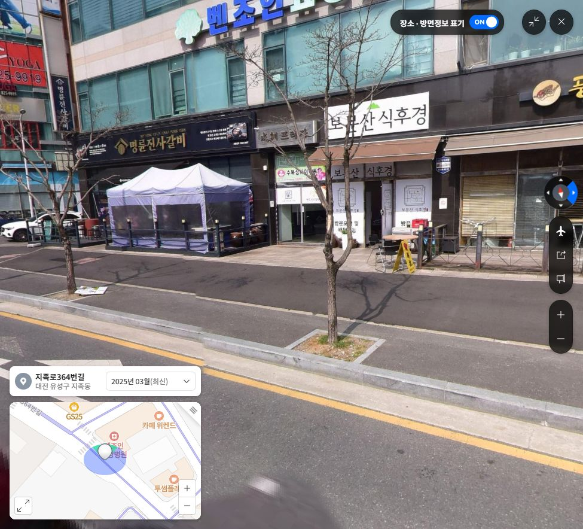

# 거리뷰 상가 배치 반영 — 2026-10-30

사용자가 확인한 건물 배치를 유지하고, 도면의 실내 복도 투영·겹침 빗금을 제거했다. 실제 게임의 내부 복도, 문, 충돌체를 삭제한 것은 아니다.

## 직접 확인한 거리뷰

- 포유하우스 보행현관 옆 풍전 코너: https://map.naver.com/p?c=17.00,0,0,0,adh&p=9HFpXSeej2Av6rXIjrgIbw,11,-9.75,64.69,Float
- 상가 앞길을 이동해서 확인한 정면: https://map.naver.com/p?c=17.00,0,0,0,adh&p=frOXxn1K994dhCPdRwdTYQ,11,-9.75,64.69,Float
- 네이버 화면 촬영 시점: 2025년 3월. 현재 영업 상태를 확인한 결과는 아니다.
- 풍전 코너에서 골목 교차로 쪽으로 **풍전돈까스 → 보문산 식후경 → 명륜진사갈비**가 이어진다. 사진 정면에서는 명륜이 왼쪽, 풍전이 오른쪽이다.
- `qa/naver-myeongryun-storefront.png`에 명륜의 검은색·금색 간판, 가운데 식후경의 흰색 간판, 풍전 방향이 함께 보인다. 거리뷰 사진은 QA 근거이며 게임 텍스처로 사용하지 않았다.

## 변경

- `right-building-upgrade.js`: 가운데 보문산 식후경 간판과 별도 유리 출입구 추가. 명륜의 검은색·금색 가로 간판, 작은 세로 간판과 단순화한 마크 적용. 풍전 본 간판과 코너 측면 간판 유지.
- 기존 CC0 `clinic-cornice.glb`를 재사용해 매장별 돌출 차양 4구간을 구성했다. 실제 천막 원단이나 상세 실내를 새로 재현했다고 주장하지 않는다.
- `clinic-window.glb`, `clinic-entry.glb`, `clinic-cornice.glb`, `clinic-cladding.glb` 네 파일을 그대로 재사용했다. 새 BoxGeometry 건물·소품 대체 모델을 만들지 않았다. 원본 출처·CC0 라이선스는 `assets/models/exterior/right-building/LICENSE.md` 참조.
- 새 외벽의 모든 메시를 기존 이웃 건물과 같은 외부 표시 레이어(3)에 맞췄다. 외부에서는 보이고, 별도 배치된 상층 실내 복도 화면에는 나타나지 않는다. 이전에는 새 GLB만 기본 레이어여서 내부 장면에 침범할 수 있었다.
- `index.html`: 외벽 스크립트 캐시 버전 갱신.
- `qa/export-layout-review.cjs`: 복도 투영을 제거한 PNG/SVG 도면과 상가 순서 반영. 출력은 `qa/layout-review-20261030/`.

## 검사와 범위

- `qa/right-building-test.cjs` 통과: 도로·바닥·충돌체·경사로·건물 위치·좀비 시작/순찰 경로, 투썸 장면 유지. GLB 폐쇄 외벽, 상가 순서, 외부 표시/상층 실내 숨김 확인.
- `qa/corridor-layer-test.cjs` 통과: 실내 소품·바닥 메시 22개가 외부에서 숨겨지고 실내에서 보이는 설정 유지.
- 실제 게임 폴더를 읽는 Chrome WebGL 장면 검사에서 네 GLB와 텍스처 로딩 성공, 콘솔 오류 0건, 실패 요청 0건. `qa/verified-shops-after-browser.json`과 화면 3장 참조.
- 브라우저 검사는 정지 장면을 필요한 때만 그리는 검사다. FPS 측정 또는 모든 게임플레이·저장 기능의 수동 재검증은 아니다. 정면 상가 캡처만 전체 간판을 보여 주기 위해 96도 검토 카메라를 사용하며, 제품의 1인칭 시야각은 변경하지 않았다.
- 외벽 모델은 85,169 삼각형 / 14 렌더 배치다. 직전 84,497 / 13에서 672 삼각형과 1배치가 증가했다. 별도 간판 평면 제외.
- 상가 문 모델은 외관용이다. 새로운 입장 가능한 매장 내부나 상점 상호작용은 이번에 추가하지 않았다. 기존 포유하우스 보행현관 기능은 변경하지 않았다.
- 전체 건물 치수와 도로는 기존 게임용 근사치다. 실제 대지 경계·실측 도면과 동일한 수준의 복원이라고 보고하지 않는다.

